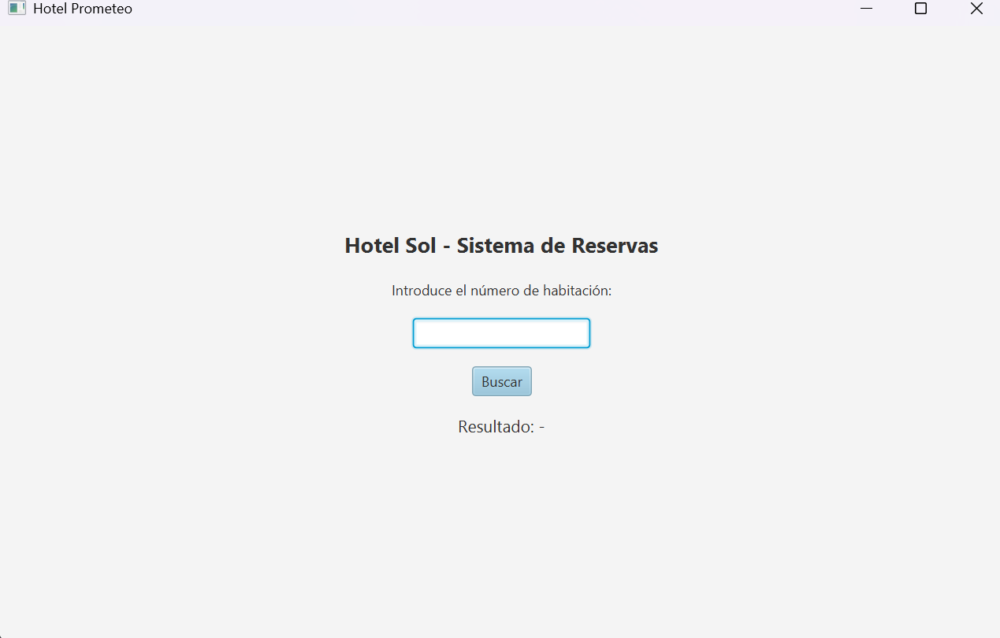
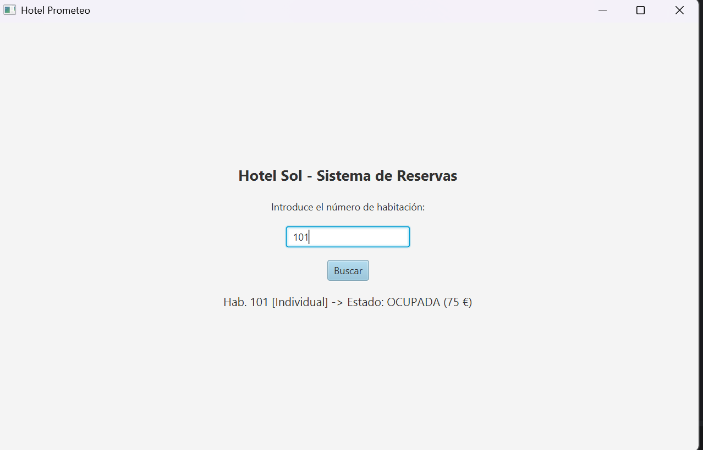
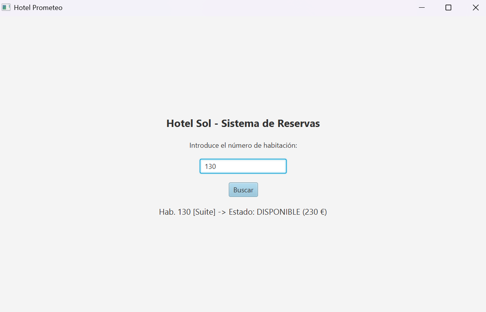
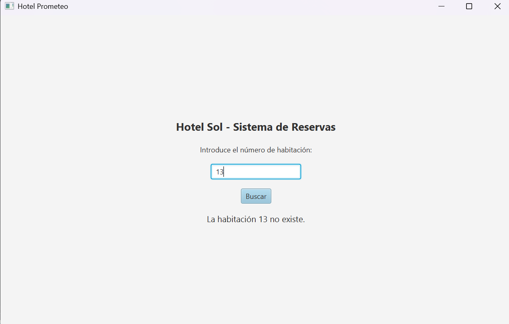

# Memoria Técnica: Sistema de Gestión de Reservas - Hotel Prometeo / Hotel Sol

**Autor:** David  
**Repositorio:** [David-Dama/HotelApp](https://github.com/David-Dama/HotelApp)  
**Fecha:** 2026  

---

## 1. Introducción y Objetivos
El proyecto **HotelApp** consiste en una aplicación de escritorio desarrollada para la consulta gráfica de disponibilidad y estados de las habitaciones de un hotel. Permite al usuario realizar búsquedas en tiempo real mediante un identificador numérico de habitación, devolviendo su tipo, tarifa y estado actual (ocupada, disponible o no existente).

---

## 2. Arquitectura del Proyecto
La aplicación está diseñada bajo el patrón de diseño **MVC (Modelo-Vista-Controlador)** o estructura por capas limpia para desacoplar la interfaz gráfica de la lógica de negocio y los datos.

### Estructura de Clases Principal
* **`Habitacion.java`**: Clase modelo que define las propiedades de una habitación (número, tipo, estado y precio por noche).
* **`Hotel.java`**: Gestor de datos y lógica de negocio. Mantiene la colección de habitaciones disponibles y procesa la búsqueda.
* **`VentanaHotel.java` / `Main.java`**: Interfaz gráfica construida con Java Swing / AWT que maneja la interacción con el usuario y la renderización del formulario.

---

## 3. Manual Paso a Paso (SBS - Step-by-Step) y Pruebas de Interfaz

A continuación se detalla el flujo de uso del sistema acompañado de las capturas de pantalla del funcionamiento de la interfaz.

### Paso 1: Inicio de la Aplicación
Al ejecutar el proyecto, el sistema abre la ventana principal con el título de la ventana y el panel central estilizado para la búsqueda.

> **Captura 1:** Vista inicial del sistema sin valores introducidos.  
> 

---

### Paso 2: Consulta de Habitación Ocupada
El usuario introduce un número de habitación (por ejemplo, `101`) en el campo de texto y pulsa el botón **Buscar**. El sistema consulta el modelo y despliega el tipo de habitación, su estado y el precio asignado.

> **Captura 2:** Consulta del estado de una habitación ocupada.  
> 

---

### Paso 3: Consulta de Habitación Disponible
Al realizar la búsqueda de otra habitación válida (por ejemplo, `130`), la aplicación responde indicando la tipología `[Suite]` junto a su estado `DISPONIBLE` y la tarifa diaria (`230 €`).

> **Captura 3:** Consulta del estado de una habitación disponible.  
> 

---

### Paso 4: Control de Errores y Validaciones
Si el usuario ingresa un número de habitación que no está contemplado en el registro del hotel (por ejemplo, `13`), la aplicación gestiona la búsqueda mediante una validación mostrando un mensaje informativo de "no existencia".

> **Captura 4:** Mensaje de error para habitación no encontrada.  
> 

---

## 4. Instrucciones para Adjuntar las Capturas en GitHub

Para que las imágenes se visualicen correctamente en tu repositorio de GitHub:

1. Crea una carpeta llamada `img` o `images` en la raíz de tu proyecto.
2. Guarda las 4 imágenes en esa carpeta con los siguientes nombres:
   * `inicio.png` (Corresponde a la primera imagen con el campo vacío)
   * `habitacion_ocupada.png` (Corresponde a la búsqueda de la hab. 101)
   * `habitacion_disponible.png` (Corresponde a la búsqueda de la hab. 130)
   * `habitacion_no_existe.png` (Corresponde a la búsqueda de la hab. 13)
3. Asegúrate de añadir tanto el archivo `.md` como la carpeta `img` al control de versiones (`git add . && git commit -m "Docs: añade memoria técnica"`).

---

## 5. Conclusiones
La aplicación cumple con los requisitos funcionales requeridos, proporcionando una interfaz rápida e intuitiva para el control básico de inventario e información de un establecimiento hotelero.